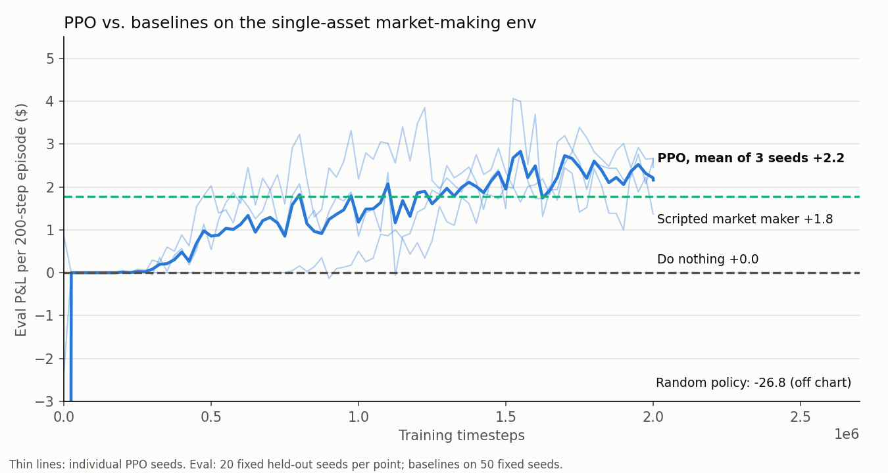
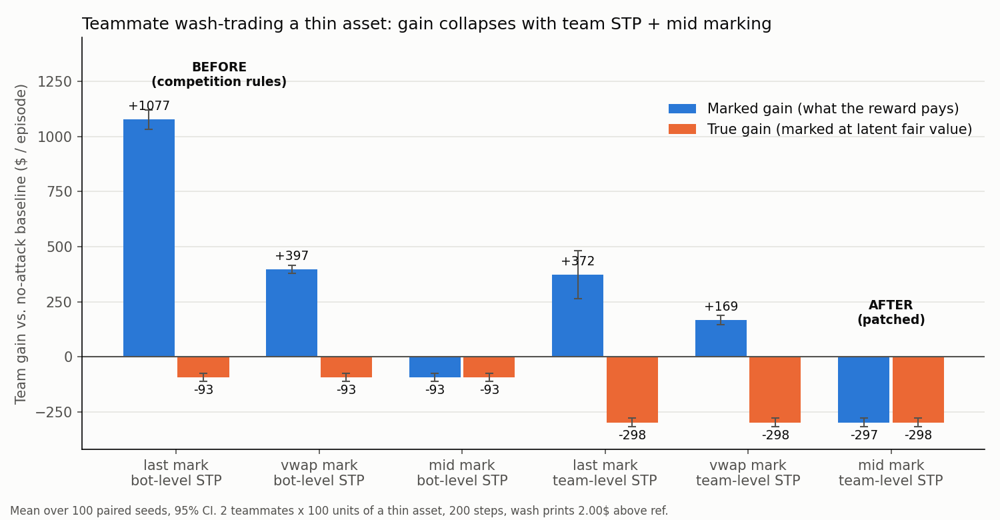

# KnightGym

Order-book RL environments built on a real price-time matching engine, plus an audit of how an agent (or two) can game the reward.

```python
import gymnasium as gym, knightgym
env = gym.make("KnightGym-v0"); obs, info = env.reset(seed=0)
obs, reward, terminated, truncated, info = env.step(env.action_space.sample())
```

(`tests/test_readme.py` executes this block.)

## The problem

Reward-hacking in trading environments is rarely about the model. It is about the accounting. In the Rutgers live trading competition this engine was built for, holdings were marked at the **last traded price**, and self-trade prevention keyed on the individual bot, not the team. Two teammate bots can therefore trade with each other in a thin asset at an absurd price. Nobody loses money, the last-trade mark jumps, and the team's marked equity goes up. Any RL environment that pays "change in marked equity" inherits the same hole.

## What was built

- `core/`: the competition exchange's order book (`matching.rs`, a trimmed `models.rs`), copied with the axum/Postgres layers removed. The matching code is unmodified.
- `py/`: a deterministic Rust market simulator on top of that book, exposed to Python with PyO3/maturin. Simulated time advances only in `step()`. Each seed fixes the fair-value walk, noise flow, and action ordering.
  - Participants: external agents, a house market maker that requotes every step (its fresh quotes can pick off stale agent orders), and Poisson noise traders.
  - Self-trade prevention can key on the bot or on the team (`team_stp`).
  - Marking rule is configurable: `last`, `mid`, or `vwap`. An oracle `fair` mark exists to measure true wealth.
- `python/knightgym/`: a Gymnasium env (L2 book + inventory observation; limit / market / cancel-all / two-sided-requote actions; reward = change in marked equity), a PettingZoo parallel env for multi-agent and team setups, scripted opponents (market maker, momentum, mean-reversion; written from scratch), and the scripted attacks.
- `scripts/`: baselines, hack suite, plots. `tests/`: 19 pytest tests (API check, determinism in-process and across processes, time only advances on `step`, P&L accounting, PettingZoo API test, hack claims). 14 `cargo test` tests.

## Results

**Engine benchmark** (single thread, i9-12950HX, shared box, 5 runs × 400k ops, orders pre-built, ~10k resting orders):

> **5.5 M orders/s** resting limit orders (p50 0.09 µs, p99 0.85 µs); **4.4 M/s** crossing-heavy mix (p50 0.12 µs, p99 0.75 µs); **12.7 M ops/s** cancel-heavy mix (p50 0.05 µs, p99 0.16 µs).

Command: `cd core && nice -n 10 cargo bench --bench latency`. Method, criterion numbers (cold-book batches are slower), and caveats are in [`results/benchmark.md`](results/benchmark.md). This is the matching core only, with no network or Python. The live competition ran at about 420 orders/s, bound by the bots and API layer. The full Python `step()` loop runs about 80k steps/s.

**PPO vs. baselines** (P&L per 200-step episode, 50 fixed held-out seeds, mid marking):

| policy | mean P&L ($) | s.e. |
|---|---|---|
| random | -26.8 | ±4.6 |
| do nothing | 0.0 | |
| scripted market maker | +1.8 | ±0.23 |
| PPO, 2M steps (3 seeds pooled) | +2.1 | ±0.34 |



PPO beats random by a mile and matches or slightly beats the scripted market maker. With 3 seeds I would not claim it is better than the market maker. PPO has higher variance and holds about 4x the inventory (about 10 units vs 3).

**Reward-hack audit.** The exploit is real in this env (`tests/test_hacks.py` checks it). The team is two agents, each holding 100 units of a thin asset, with 100 paired seeds and a no-attack baseline on the same seeds. "Marked" is what the reward pays. "True" marks inventory at the latent fair value.



| attack | marking | STP | marked gain $ | true gain $ |
|---|---|---|---|---|
| wash trade | last | bot | **+1077 ± 44** | -93 ± 19 |
| wash trade | vwap | bot | +397 ± 19 | -93 ± 19 |
| wash trade | mid | bot | -93 ± 19 | -93 ± 19 |
| wash trade | last | team | +372 ± 109 | -298 ± 19 |
| wash trade | mid | team | -297 ± 19 | -298 ± 19 |
| sweep-pump (no teammate) | last / vwap / mid | any | +48 / +50 / -93 | -93 |
| quote spoof | mid | any | +19 ± 8 | -22 ± 5 |

The full table is in [`results/hack_results.md`](results/hack_results.md).

- The patch, team-level STP plus mid marking, takes the hacker from +$1077 marked to -$297, and marked equals true. The reward now says what actually happened.
- The two halves are not interchangeable. Mid marking alone ignores the wash prints. Team STP alone still leaves +$372, because the attacker's leftover bid gets lifted by the house at the print price. VWAP alone is weak, since wash volume swamps real volume in a thin asset.
- Remaining leaks: with last or vwap marking, a lone agent can buy out the few real asks below a high price (+$48). With mid marking, quote spoofing is bounded by half the spread (+$19 marked while really losing $22).

## What surprised me

- PPO first collapsed to exactly "do nothing" (1M steps, one order per step, plain rewards; that run's file was overwritten). Adding a requote action (cancel plus two-sided quote in one step, since a single order per step can't express market making) was not enough on its own: the next run (1M steps, plain rewards) still scored -0.9 / -0.1 / ~0 across seeds (`results/baselines_v1_plain.json`). Reward normalization plus 2M steps got it to the numbers above. Hyperparameters were adjusted once after seeing eval results, on the same eval seeds used for the table, so treat the PPO number as mildly optimistic.
- Team-level STP on its own looked like the fix, and wasn't. The attacker adapts by paying the house for a high print.
- The wash trade is free to the team, so true wealth only falls from side costs. That is why reward and true wealth diverge so cleanly.

## Limits and next steps

- The market is stylized: random-walk fair value, synthetic house and noise flow, one thin asset in the audit. Nothing here is calibrated to real data.
- The competition's marking and STP rules come from my project notes, not from re-reading the live leaderboard code. Team STP is modeled by keying the engine's owner id on the team.
- No price collars or circuit breakers. Those are a natural third patch to test.
- Next: a learned attacker (does PPO discover the wash trade by itself in the multi-agent env?), more assets, and calibrated flow.

## Reproduce

```
python -m venv --system-site-packages .venv && . .venv/bin/activate
pip install maturin gymnasium stable-baselines3 pettingzoo matplotlib pytest
maturin develop --release
cargo test --workspace && pytest
python scripts/baselines.py 2000000 && python scripts/plot_curve.py
python scripts/hack_suite.py && python scripts/plot_hack.py
```
